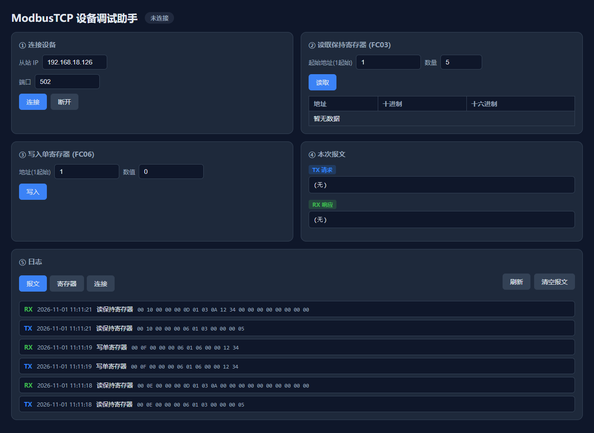
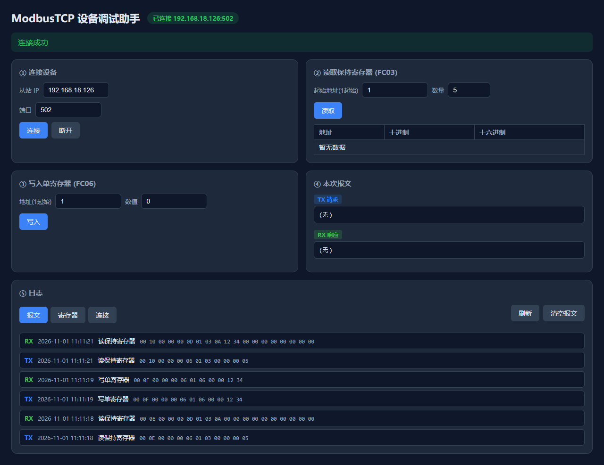
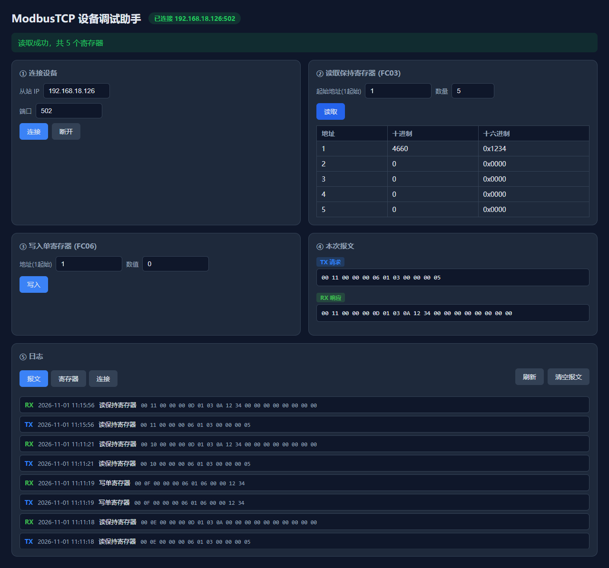
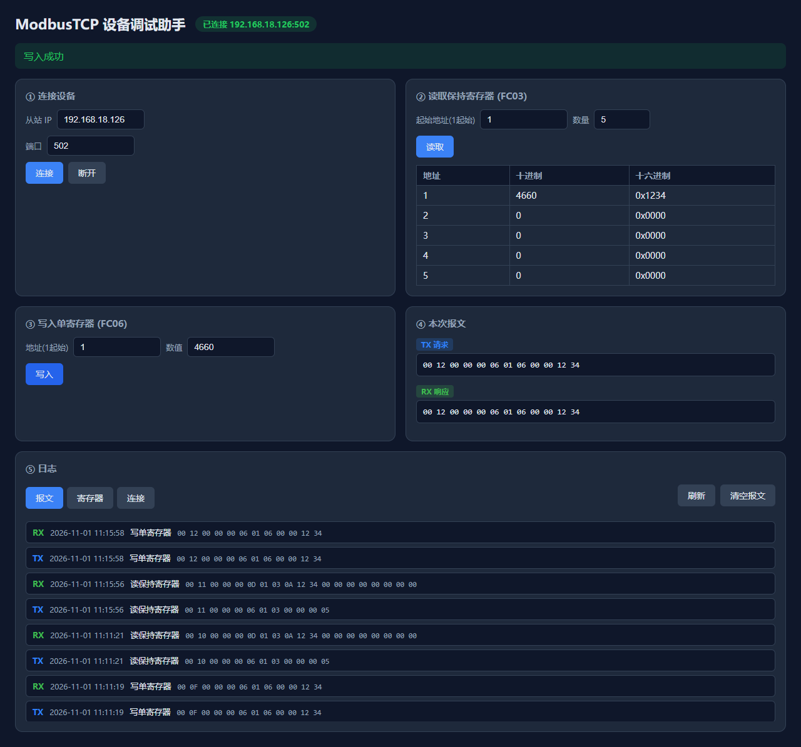

# ModbusTcpDebugHelper

C# Web 版 ModbusTCP 调试小工具 | 个人兴趣 Demo

> AI 辅助生成基础代码，人工完成协议实现、报文解析、异常处理、本地测试调优。

## 项目简介

面向工业设备调试场景的轻量 ModbusTCP 主站客户端。

机械产线现场，RS485 仪表接入 IoT 网关，网关将 Modbus RTU 转为 ModbusTCP。本工具后端封装 REST API，前端网页提供操作界面，快速和 Modbus 从站（仿真软件/现场网关）通信，读写保持寄存器，查看原始通信报文，排查链路故障。

**核心亮点：手写 Modbus TCP 协议栈**（不依赖第三方 Modbus 库），直接构建/解析 MBAP 头 + PDU，因此发送与接收到的字节就是真实报文，可原文打印查看。

## 技术栈

- 语言：C#
- 框架：.NET 8 + ASP.NET Core Web API（Controller 风格，类比 Java Spring MVC）
- 前端：原生 HTML / JS / CSS（fetch 调用 API）
- 存储：SQLite（当前内存库，可切换文件持久化）
- IDE：JetBrains Rider（兼容 Visual Studio 2022）

## 功能清单

1. REST API：连接/断开、读保持寄存器（FC03）、写单寄存器（FC06）、日志查询
2. Web 前端：按钮操作、结果表格、状态徽标
3. 原始收发 Modbus 十六进制报文展示，辅助排查通信问题
4. SQLite 记录连接历史、寄存器读写、收发报文三类日志
5. 输入校验、友好中文错误提示、全局异常处理

## 运行截图

**① 首页**


**② 连接从站**


**③ 读取保持寄存器**


**④ 写入单寄存器**


**⑤ 回读确认**


**⑥ 查看报文日志**


## 运行步骤

1. 启动 Modbus Slave 仿真软件，开启 Modbus TCP 服务（目标地址见 `appsettings.json` 的 `Modbus:DefaultHost/Port`）
2. `dotnet run` 启动本程序
3. 浏览器打开 `http://localhost:8080`
4. 点击「连接」，再点击「读取/写入」执行操作，查看返回数据与原始报文日志

## 配置

`appsettings.json`：

- `Web:Url` — 本程序监听地址
- `Modbus:DefaultHost` / `Modbus:DefaultPort` — 从站默认目标（前端预填）
- `LogStore:ConnectionString` — 日志连接串，`Data Source=:memory:` 为内存库；改 `Data Source=modbus.db` 即落盘持久化

## 目录结构

```
├─ Controllers/       # ModbusController、LogController
├─ Services/          # ModbusClientService（手写协议）、LogStore（SQLite）
├─ Models/            # DTO
├─ wwwroot/           # 前端静态页
└─ appsettings.json   # 配置
```

## IDE 支持

标准 .NET 8 Web 工程：

- ✅ JetBrains Rider（本项目开发 IDE）
- ✅ Visual Studio 2022 可直接打开编译运行